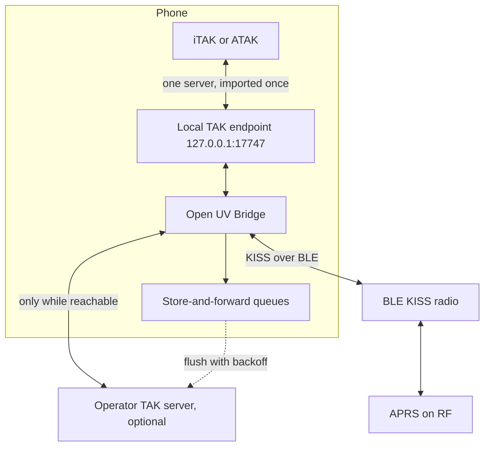

# Architecture

Open UV Bridge lets an iPhone (and an Android phone) use a BLE KISS handheld with iTAK or ATAK. iTAK has no plugin system, so the phone hosts the TAK server itself. That is the same shape described in Meshtastic's iOS write-up. Meshtastic-Apple is GPL-3.0 and was not copied.

iTAK is given **one** server, `127.0.0.1:17747`, and that entry never changes. The operator's own TAK server is a second socket inside the bridge. The bridge opens it when the phone can reach it and queues when it cannot.

## Offline

No cell, no internet, no server. APRS is radio to radio. The local endpoint still feeds iTAK: map pins, contacts, and GeoChat carried as APRS messages. Positions and chats meant for the operator's TAK server sit in the queue.

## Online

`NWPathMonitor` on iOS, and the connection itself, decide reachability. When the path is up and the upstream socket finishes its handshake, the mode is `bridging`. The queue flushes. Positions coalesce to the latest per uid. Chats are not coalesced. A dropped socket backs off 1, 2, 4, 8, 16, 32, then 60 seconds.

Stations are stored by uid (`APRS-WA7BRM-7`). A station heard on RF and again from the server is one row, with both sources recorded. Events this bridge sent upstream carry a `txid` in `<uvbridge>`. If the server echoes them, they are not drawn a second time.

By default, server stations that have never been heard on RF are not pushed into iTAK. That keeps a large TAK picture from flooding the phone. "Show the whole server map" turns the mirror on. GeoChat that names the operator or an RF station still comes down. Anything that would be transmitted is still judged by the Part 97 guard: no encryption, a callsign is required, and other people's traffic stays off the radio unless the operator turns that on.

## Radio

Firmware 0.7.11 and later on the UV-PRO exposes the open BLE KISS service from [hessu/aprs-specs](https://github.com/hessu/aprs-specs/blob/master/BLE-KISS-API.md):

| Role | UUID |
| --- | --- |
| Service | `00000001-ba2a-46c9-ae49-01b0961f68bb` |
| TX write | `00000002-ba2a-46c9-ae49-01b0961f68bb` |
| RX notify | `00000003-ba2a-46c9-ae49-01b0961f68bb` |

The same service is what Mobilinkd, PicoAPRS, the VR-N76, and the GA-5WB advertise. The radio accepts one BLE link. If the manufacturer's app is open, the bridge says so and waits.

Bytes are a KISS stream, then AX.25 UI, then APRS. Parsed traffic includes uncompressed and compressed positions, Mic-E, objects, items, status, and messages with ack and retry. APRS messages are limited to 67 characters. The default beacon path is `WIDE1-1,WIDE2-1`. SmartBeaconing paces position beacons. The callsign field starts blank.

## CoT

An APRS station becomes a CoT event. The uid is `APRS-<call>-<ssid>`. The symbol picks a 2525 type for the iTAK icon. The comment is the remarks. Positions go stale in 30 minutes, objects in 60. APRS messages become GeoChat, and a GeoChat the operator addresses to a callsign becomes an APRS message. All Chat is not sent to RF.

The local listener speaks CoT XML over TCP. A TAK protobuf frame (leading `0xBF`) is consumed so it cannot desync the XML parser, and it is logged. Whether iTAK will stay on plain TCP while both apps are backgrounded is the M0 check in [TESTING.md](TESTING.md). TLS on the loopback port is a setting if that check says iTAK requires it.

Upstream TLS is for the operator's server only. Client certificates come from an imported enrollment package. The Marti `POST /Marti/api/tls/signClient/v2` URL is built when a host is configured. No server name is compiled in.

## Where the code lives

`UVBridgeCore` is pure Swift: KISS, AX.25, APRS, CoT, the Part 97 guard, the mode machine, and the data-package zip. It builds on Linux. The iOS target adds Core Bluetooth, Network.framework, and Core Location. The Android app is Kotlin in this same repo. It uses BLE KISS and, when that service is missing, Bluetooth Classic SPP. iOS cannot open SPP. After the bytes leave the radio they are the format in [ON-AIR-FORMAT.md](ON-AIR-FORMAT.md). `testdata/on-air-vectors.json` is loaded by both `swift test` and `./gradlew test`.
